# CareTrack — Frontend

Admin web client for **CareTrack (Doctor Tracker)**, built with Next.js 16, React 19, TypeScript, Tailwind CSS 4, shadcn/ui, TanStack Query, React Hook Form + Zod and Recharts.

| | |
|---|---|
| **Frontend repo** (this) | https://github.com/NoManNayeem/CareTrack_Frontend |
| **Backend repo** | https://github.com/NoManNayeem/CareTrack_Backend |
| **Live app** | https://caretrackfrontend.vercel.app |
| **Live API** | https://caretrackbackend.vercel.app/api/v1/health |
| **Demo credentials** | `admin@caretrack.dev` / `CareTrack@2026` (also a one-click button on the sign-in page) |

### Project walkthrough video

<!-- Walkthrough video -->
<a href="https://youtu.be/_p9CORnn2bA">
  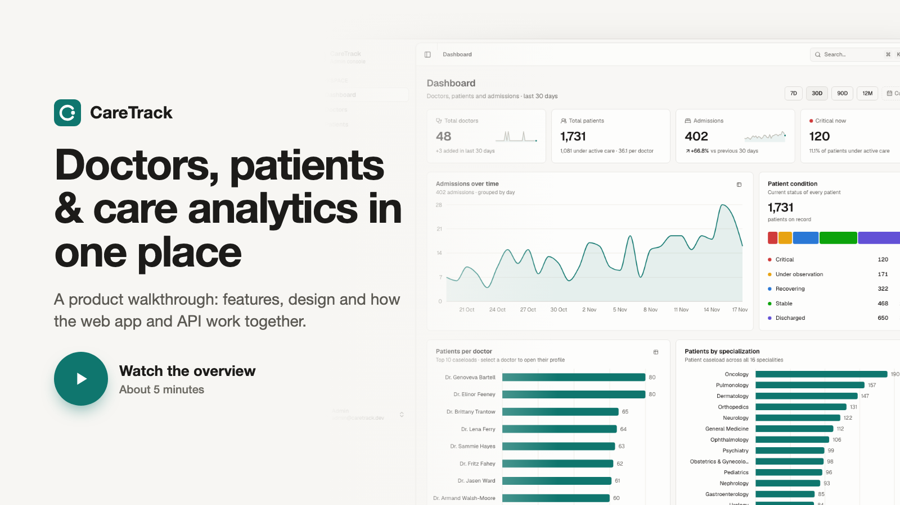
</a>

▶ **[Watch the walkthrough (~5 min)](https://youtu.be/_p9CORnn2bA)**: a product tour of CareTrack, what it does and how the frontend and backend work together.

---

## Description

CareTrack is a secure admin portal for hospitals and clinics to manage doctors and the patients under their care. Once signed in, an administrator can:
- **Doctors:** register them, find any doctor with search, filters and pagination, and open their profile to see their full caseload.
- **Patients:** add or remove patients under a doctor, and edit, reassign or delete them from a dedicated Patients page with search and filters by condition, date, sex, age and doctor.
- **Dashboard:** follow totals, patients per doctor, the current condition mix and admission trends, with interactive charts.

This repository is the **web client**. It talks to the standalone [CareTrack API](https://github.com/NoManNayeem/CareTrack_Backend) only over REST. Design priorities are a calm, professional interface, instant navigation, and accessibility on both desktop and phone.

---

## Setup Guide

### Prerequisites

| Tool | Version | Needed for |
|---|---|---|
| Git | any | cloning |
| Docker Desktop | 4.x (Compose v2) | **Option A**: full stack in containers (recommended) |
| Node.js + npm | **24.x** (see `.nvmrc`) + npm 11 | Option B and running tests |

The client needs a running **CareTrack API**. Both options below include it.

### Option A — Full stack with Docker (recommended)

Clone both repositories **side by side**:

```bash
mkdir CareTrack && cd CareTrack
git clone https://github.com/NoManNayeem/CareTrack_Backend.git
git clone https://github.com/NoManNayeem/CareTrack_Frontend.git
```

**1. Start the API and database** (this creates the shared `caretrack-net` network):

```bash
cd CareTrack_Backend
docker compose up -d --build --wait
docker compose --profile seed run --rm seed      # 1 admin · 48 doctors · ~1,700 patients
cd ..
```

**2. Start the web client** (it joins `caretrack-net` and reaches the API at `http://api:4000`):

```bash
cd CareTrack_Frontend
docker compose up -d --build --wait
```

**3. Open the app:** go to **http://localhost:3000** and sign in with `admin@caretrack.dev` / `CareTrack@2026`.

| Service | URL |
|---|---|
| Web app | http://localhost:3000 |
| API | http://localhost:4000/api/v1/health |
| MongoDB | `mongodb://localhost:27017/caretrack` |

To stop everything, run `docker compose down` in each folder. Add `-v` in the backend folder to also delete the database.

### Option B — Run the client with Node.js (hot reload)

1. Start the API using either option in the [backend Setup Guide](https://github.com/NoManNayeem/CareTrack_Backend#setup-guide). It should answer on `http://localhost:4000`.
2. Then:

```bash
cd CareTrack_Frontend
cp .env.example .env.local     # API_URL=http://localhost:4000 is already set
npm ci
npm run dev                    # http://localhost:3000
```

For a production build: `npm run build && npm start`.

### Environment variables (`.env.example`)

```dotenv
API_URL=http://localhost:4000
SESSION_COOKIE_NAME=ct_session
NEXT_PUBLIC_DEMO_MODE=true
NEXT_PUBLIC_DEMO_EMAIL=admin@caretrack.dev
NEXT_PUBLIC_DEMO_PASSWORD=CareTrack@2026
```

| Variable | Purpose |
|---|---|
| `API_URL` | Where the API lives. **Server-side only**: it's the target of the `/api/*` rewrite and never reaches the browser. In Docker it's a build argument (default `http://api:4000`). |
| `SESSION_COOKIE_NAME` | Must match the API's `COOKIE_NAME`. |
| `NEXT_PUBLIC_DEMO_*` | Shows a "Use demo credentials" button on the sign-in page. These are public demo values, not secrets. Set `NEXT_PUBLIC_DEMO_MODE=false` to hide it. |

`.env.local` and every other `.env*` file are ignored by Git; only `.env.example` is committed.

### Run the checks

```bash
npm run lint            # ESLint (Next.js core-web-vitals + TypeScript rules)
npm run typecheck       # route type generation + TypeScript 7
npm run format:check    # Prettier, including Tailwind class ordering
npm test                # Vitest unit tests

# End-to-end tests (needs the Docker stack from Option A running)
npx playwright install chromium
npx playwright test --project=e2e      # route protection · doctor → patient lifecycle · dashboard
npm run screenshots                    # regenerates docs/screenshots/*
```

### Troubleshooting

| Symptom | Fix |
|---|---|
| `network caretrack-net declared as external, but could not be found` | Start the backend's compose stack first (step 1) |
| Sign-in keeps returning to the login page | The API isn't reachable at `API_URL`. Check `curl localhost:4000/api/v1/health`, and make sure the backend's `FRONTEND_URL` is `http://localhost:3000` |
| Changed `API_URL` but Docker still uses the old one | Rewrites are fixed when the image is built. Re-run `docker compose up -d --build` |
| `port is already allocated` (3000) | Stop the local `npm run dev`, or change the published port in `docker-compose.yml` |

---

## System Architecture

### How the pieces talk to each other

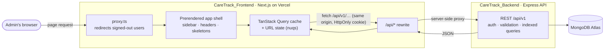

### What happens when an admin filters the patient list

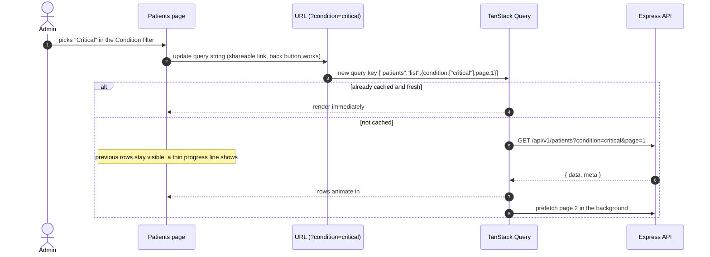

### Rendering and auth

- **Instant navigation.** Cache Components and Partial Prefetching are on, so every route's shell is **prerendered at build time**: `/dashboard`, `/doctors` and `/patients` are static, and `/doctors/[id]` is partially prerendered. Moving between sections shows the next screen right away. Data streams into skeletons that match the final layout, so nothing jumps around.
- **Data comes only from the API.** TanStack Query requests go to the same-origin `/api` rewrite. A single key factory (`lib/query-keys.ts`) lets each change invalidate exactly what it affects.
- **Signing in and out.**
  - `proxy.ts` redirects signed-out visitors to `/login?next=…`. It only checks that the session cookie exists and hasn't expired; the API verifies everything else on every request.
  - Any `401` from the API clears the cache and returns to `/login?reason=expired`.
  - `next` only accepts same-site paths, so it can't be used as an open redirect.

### Code structure

```
app/
├── (auth)/login/            split-screen sign-in with a product preview
├── (portal)/                shared shell: sidebar · top bar · mobile tab bar · page transition
│   ├── dashboard/  doctors/  doctors/[id]/  patients/
│   └── error.tsx
├── layout.tsx · globals.css (design tokens) · icon.svg · not-found.tsx
proxy.ts                     route protection (Next 16 "proxy", formerly middleware)
components/
├── ui/                      shadcn/ui (Radix) primitives, themed through tokens
├── layout/                  sidebar · top bar · breadcrumbs · ⌘K command menu · mobile tab bar
├── data/                    DataTable (table on desktop, cards on mobile) · PaginationBar · skeletons
├── filters/                 SearchInput · FacetedFilter · DateRangeFilter · ActiveFilters chips
├── forms/                   DoctorCombobox · HospitalCombobox · DatePicker · ConditionSelect · FormSheet
├── charts/                  ChartCard (with table view) · KpiTile · Sparkline · chart components
└── feedback/                ConditionBadge · EmptyState · ErrorState · ConfirmDialog
features/<domain>/           api.ts · hooks.ts · search-params.ts · views & forms  (auth · doctors · patients · dashboard)
lib/                         api-client · query-keys · validation (Zod) · constants · dates · format · motion
```

### Requirements → implementation

| Requirement (spec) | Implementation |
|---|---|
| Only authenticated users; protected routes | `proxy.ts` redirect, plus the API's `authenticate` / `requireRole('admin')` on every resource. An expired session sends you back to sign-in |
| Create doctor: name, specialization, hospital, phone, email | **Doctors → Add doctor** sheet. Zod rules match the API's, and server errors (such as a duplicate email) appear under the right field |
| List, search, filter (date-wise + others) and paginate doctors | `/doctors`: search by name, email or phone; filter by specialization, hospital and date added; sort; page size; all saved in the URL |
| View a doctor's patients; add; delete | `/doctors/[id]`: profile, caseload stats, condition bar, filterable patient table, **Add patient**, **Remove** with confirmation |
| Patients page: list, edit, delete, paginate, search, filter (date, condition, others) | `/patients`: filters for condition, sex, age group, doctor and admission date. Edit opens a sheet that can also reassign the doctor. Deletes update instantly and roll back if the server fails |
| Dashboard: totals, patients per doctor, date-based stats, charts | `/dashboard`: KPI tiles, admissions over time, condition breakdown, top-10 caseloads, all 16 specialities, age bands, recent admissions; 7D / 30D / 90D / 12M / custom range |
| Clear navigation between Dashboard, Doctors, Patients | Collapsible sidebar, breadcrumbs, ⌘K search, and a bottom tab bar on phones |
| Avoid unnecessary re-renders; reusable components | React Compiler, URL-driven state, uncontrolled form inputs, debounced search; one `DataTable`, one filter set and one `FormSheet` shared by every list |

---

## Technical Decisions

### 1. URL state + TanStack Query instead of Redux (or a Context store)

**Context.**
- Every list screen combines search, several filters, a date range, sort, page and page size.
- Changes ripple: adding a patient changes the doctor's patient count, the patients list and the dashboard.
- **Redux** would copy *server* data onto the client, and every cache rule would be hand-written: staleness, refetching, invalidation, optimistic rollback.
- **A Context store** re-renders every subscriber whenever any value changes.

**Decision.** State is split by **who owns it**:

| State | Owner | Tool |
|---|---|---|
| Lists, details, analytics | the API | **TanStack Query**: one key factory · `staleTime` 30 s · previous page stays visible while paging · next page prefetched · doctor detail prefetched on row hover |
| Search, filters, dates, sort, page | the **URL** | **nuqs**: typed parsers per screen (`features/*/search-params.ts`) |
| Form values and errors | the form | **React Hook Form + Zod**: uncontrolled inputs, so typing doesn't re-render the form |
| Open sheet, row being deleted | the component | `useState` |

**Why it's better here.**
- **Shareable and reload-proof.** `/patients?condition=critical&from=2026-10-01` reopens exactly the same view, and the back button works.
- **One source of truth for server data.**
  - Each change invalidates only what it affects (`doctors.*`, `patients.*`, `analytics.*`).
  - Deletes are **optimistic**: the row slides out at once and comes back with a message if the server refuses.
  - Edits patch the row in every cached list immediately.
- **Fewer re-renders.**
  - Search typing is debounced (300 ms) in local state.
  - React Compiler memoises components automatically.
  - KPI numbers count up by writing straight to the DOM, without re-rendering.

**Trade-off.** There's no single store to inspect. The TanStack Query Devtools (in development) and the URL itself cover that.

### 2. Prerendered shells + client-side data instead of server-rendering data on every request

**Context.**
- With Cache Components, anything that reads per-user data has to stream behind `<Suspense>`.
- Fetching that data in Server Components would cost an extra server-to-API hop on every navigation.
- It would also fetch data twice (once on the server, again on the client for interactivity), and turn every filter change into a server round trip.

**Decision.**
- **Pages are static shells.** Sidebar, headers, toolbars and layout-matched skeletons are prerendered at build time and served from the CDN.
- **Live data loads in the browser** through TanStack Query.
- **Partial Prefetching** fetches the next route's shell before the click.
- **Each view owns one `<Suspense>` boundary**, so loading never shifts the layout.

**Consequences.**
- Navigation between sections is instant.
- Filtering, paging and sorting are a URL change followed by a cached or prefetched query, with no full page render.
- The API remains the single data source.
- **Trade-off:** the first visit shows skeletons for about one API round trip. Repeat visits show cached data immediately.

The backend README covers two more decisions: the **same-origin proxy for the HTTP-only cookie** and the **index and search design**.

---

## Visual Evidence

Generated with `npm run screenshots` (Playwright) against the seeded Docker stack.

### Desktop (1440 × 900)

| Dashboard — light | Dashboard — dark |
|---|---|
| 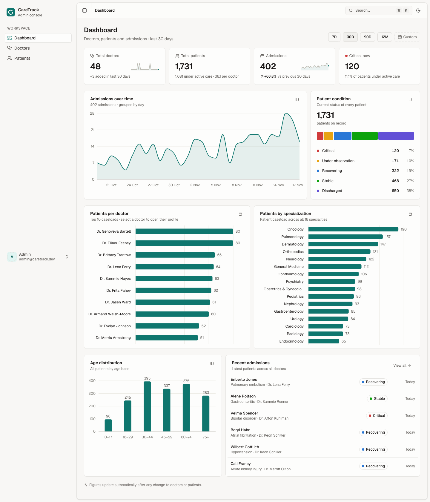 | 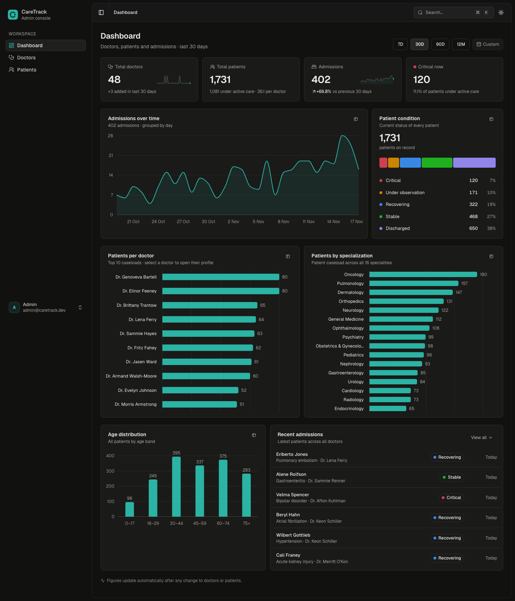 |

| Doctors directory | Doctor profile & patients |
|---|---|
| 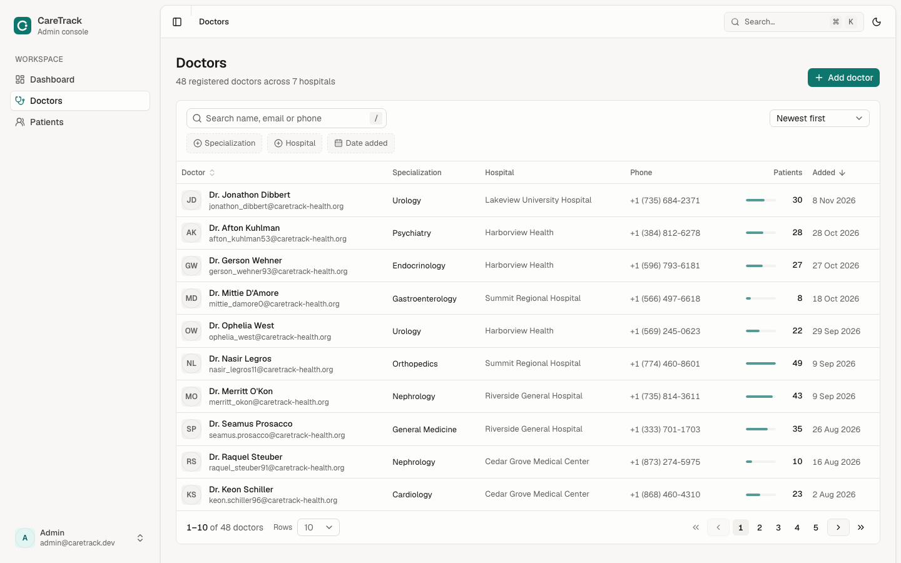 | 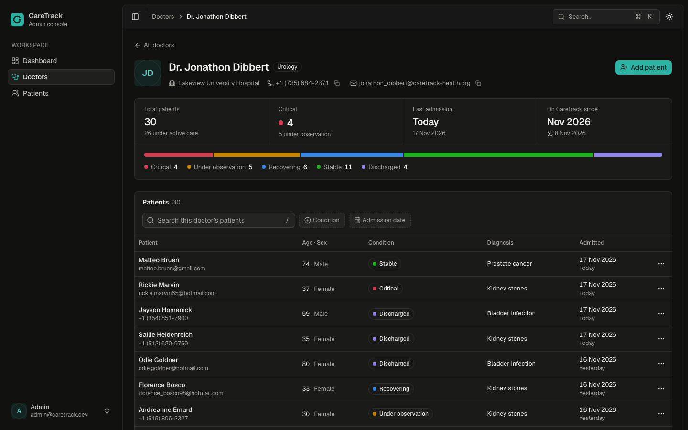 |

| Patients (filtered: critical + under observation) | Sign in |
|---|---|
| 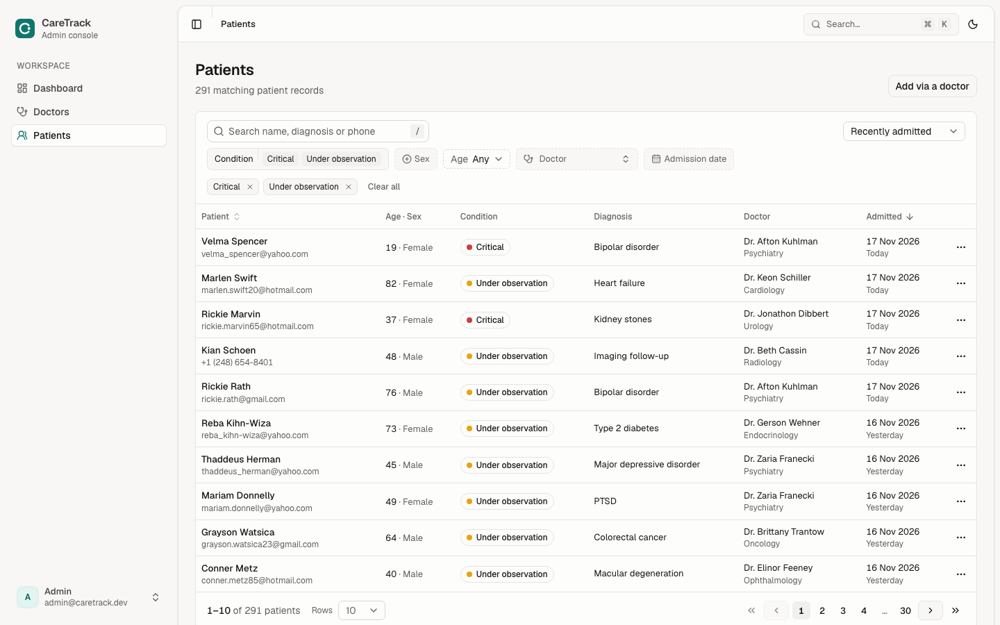 | 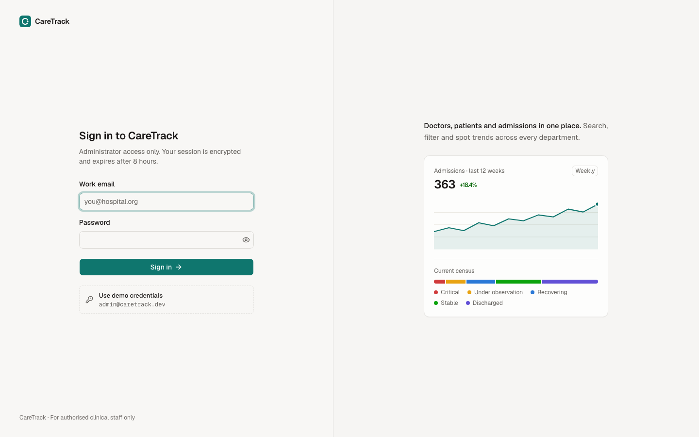 |

### Mobile (390 × 844)

| Dashboard | Doctors | Doctor profile | Patients | Sign in |
|---|---|---|---|---|
| 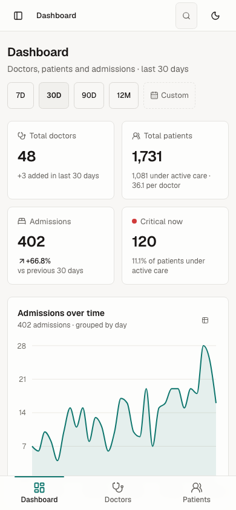 | 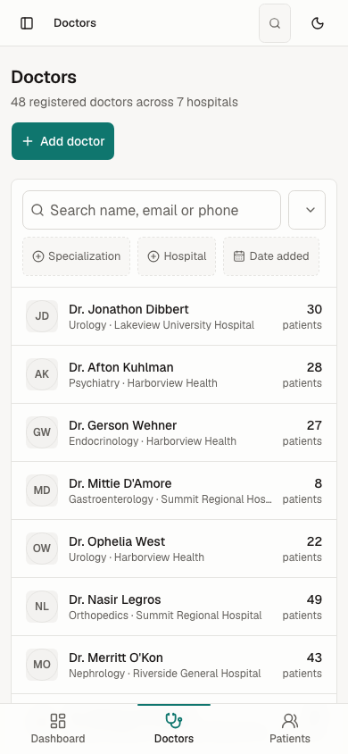 | 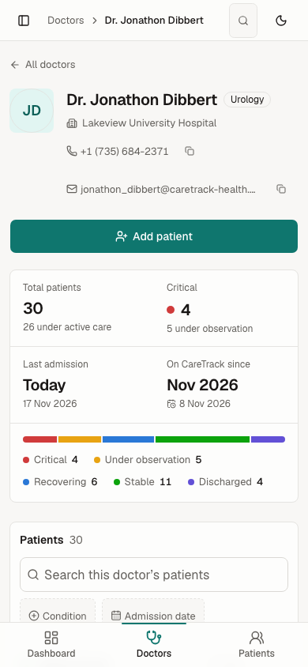 | 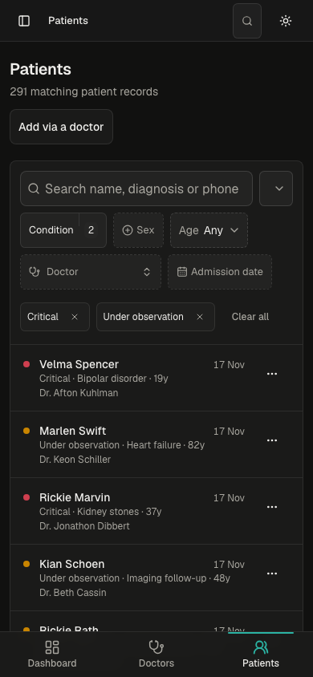 | 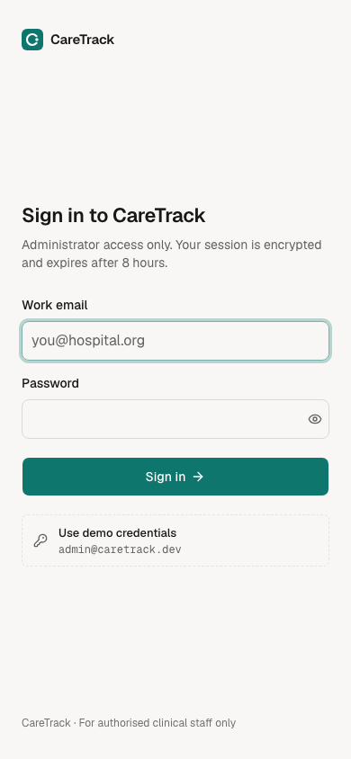 |

Dark-mode versions of every screen are in [`docs/screenshots`](docs/screenshots).

---

## Appendix

### UI/UX standards applied

| Area | What the app does |
|---|---|
| Accessibility | Text contrast is at least 4.5:1 in light and dark modes, including chart axes. Focus rings are always visible. Every icon-only button has a label. Rows, menus, sort headers and charts work by keyboard. Form errors are linked to their fields, and sortable headers expose `aria-sort` |
| Touch | On touch screens, controls grow to **44 × 44 px** and spacing to at least 8 px. Desktop keeps its compact layout. Nothing depends on hover alone: every hover action also works by tap or click |
| Status colours | Patient condition is always a **dot plus a text label**, never colour alone. The five condition colours were checked for colour-blind separation in both themes |
| Typography | Geist Sans. No text smaller than 12 px. Inputs are 16 px on phones, so iOS doesn't zoom. Numbers in columns use aligned (tabular) figures |
| Motion | One easing curve, three durations (120 / 180 / 260 ms), exits faster than entrances. Only transform and opacity animate, never width or height. Everything turns off when the system asks for reduced motion |
| Layout | Mobile-first. Below 768 px, tables become cards and a bottom tab bar appears. No horizontal scrolling, and zoom is never disabled |
| Feedback | Skeletons match the final layout. Empty states explain what happened and offer the next step. Errors come with a retry button. Toasts confirm every change. A thin progress line shows while a new page loads |
| Charts | One accent colour, values labelled directly, a tooltip on hover or focus, a **table view** for every chart, and click-through from the doctor bars and the condition breakdown |

### Docker

- **`Dockerfile`** is a multi-stage build that ends in a non-root `node:24-alpine` runtime with a `HEALTHCHECK`.
  - It uses Next's `output: "standalone"`, switched on only when `NEXT_OUTPUT=standalone`, so Vercel builds are unaffected.
  - `API_URL` is a **build argument**, because rewrites are fixed when the image is built.
- **`docker-compose.yml`** runs the web container and joins the backend's `caretrack-net` network.
- **`.dockerignore`** keeps `.env*` files and test artifacts out of the image.

### CI/CD (`.github/workflows/ci-cd.yml`)

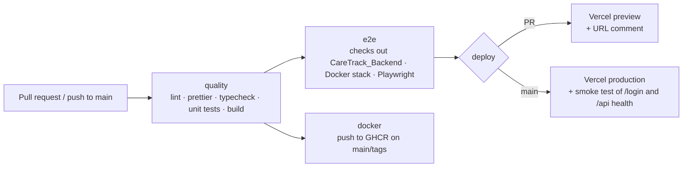

- **e2e** starts the real API and MongoDB from the backend repository, then runs the browser tests against the container built from this repo.
- **Hosting:** Vercel's Git integration builds and deploys every push to `main` (production) and every pull request (preview). The workflow's `deploy` job is an optional alternative that deploys only after quality and e2e pass. It turns on when the Vercel secrets are added; if you use it, disable Git deployments in the Vercel project.
- **No secrets in the repository.**
  - Vercel credentials are GitHub Actions secrets, used only in the deploy job and masked in logs.
  - `API_URL` is set in Vercel's project settings.
  - When the secrets are missing (for example on forks), the deploy job skips cleanly.
- **Images** are published as `ghcr.io/nomannayeem/caretrack_frontend:{sha,latest,semver}`.
- **Dependabot** updates npm packages, Actions and the Docker base image every week.

### Deploying on Vercel (free Hobby plan)

1. Deploy the backend first and copy its URL.
2. Import this repository into Vercel. Set `API_URL=https://<backend>.vercel.app`, plus the `NEXT_PUBLIC_DEMO_*` variables if you want the demo button.
3. Set the backend's `FRONTEND_URL` to this app's URL.
4. Add the `VERCEL_TOKEN`, `VERCEL_ORG_ID` and `VERCEL_PROJECT_ID` secrets to this GitHub repository.

### Toolchain note

TypeScript **7** (the native compiler) doesn't have the JavaScript API that `typescript-eslint` needs yet. Both versions are installed side by side:
- `typescript` → `@typescript/typescript6`, used by ESLint
- `@typescript/native` → `typescript@7`, which provides `tsc`

Type-checking and `next build` use TypeScript 7.
